

  <a href="https://saakshi.dev">
    <picture>
      <source media="(prefers-color-scheme: dark)" srcset="brand/logo/wordmark-on-dark.svg">
      
    </picture>
  </a>

  <b>A witness that never looks away.</b> 
  A calculator on her phone that silently records, encrypts every five seconds and seals the evidence on Polygon, so anyone can check it.

  <a href="https://web-alpha-orcin-85.vercel.app/?demo"><b>Try the live app</b></a> &nbsp;·&nbsp;
  <a href="https://saakshi.dev">saakshi.dev</a> &nbsp;·&nbsp;
  <a href="https://saakshi.dev/verify">Verify a file</a> &nbsp;·&nbsp;
  <a href="#how-a-recording-becomes-proof">How it works</a>

  
  
  

<a href="https://saakshi.dev">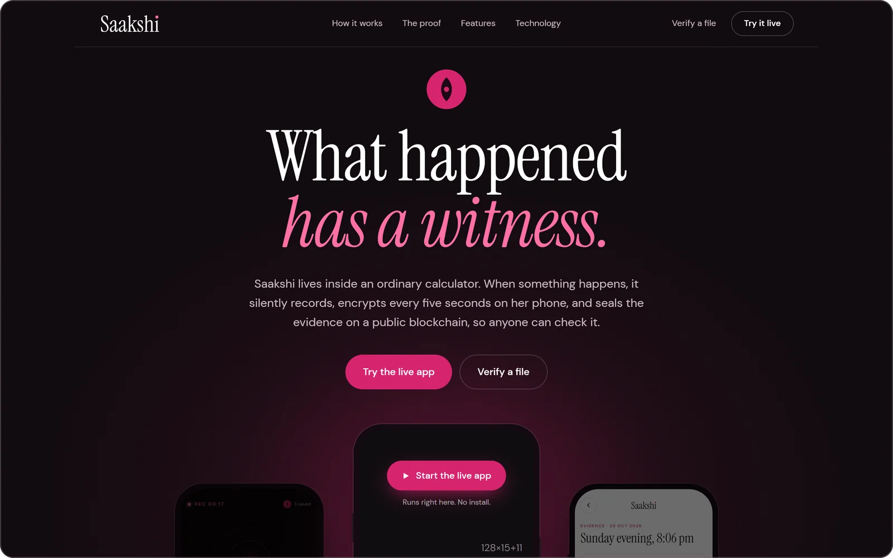</a>

*Saakshi* means witness. It is a web app (PWA) that looks and works like an ordinary calculator. Behind it, a woman can start a silent SOS that records audio, video and location in encrypted 5-second pieces, fingerprints each piece on her phone, and seals the fingerprints on Polygon, so the evidence survives even if the phone is taken and anyone can check it hasn’t been changed.

Built solo by team **Appvengers** for the SHAKTI Hackathon (Women Safety / Blockchain track, “Dharma & Trust”).

| | |
|---|---|
| **Try it** | [web-alpha-orcin-85.vercel.app/?demo](https://web-alpha-orcin-85.vercel.app/?demo): a demo setup with PIN **1931** (then `=`) and duress PIN **0000**. Tap the calculator display three times to start an SOS. The app’s address is deliberately plain: if someone checks her phone, they find a calculator and a forgettable address, nothing that says she’s collecting evidence against them. |
| **About it** | [saakshi.dev](https://saakshi.dev), with the app running live inside a phone |
| **Verify a file** | [saakshi.dev/verify](https://saakshi.dev/verify) |
| **Contract** | `EvidenceAnchor` on Polygon Amoy, [`0x39eA5AB65824af57297cE863CB54B1A84E3C4719`](https://amoy.polygonscan.com/address/0x39eA5AB65824af57297cE863CB54B1A84E3C4719). Source code [verified on Sourcify](https://repo.sourcify.dev/80002/0x39eA5AB65824af57297cE863CB54B1A84E3C4719) as an exact match. |

## Thirteen seconds of Saakshi

<table>
  <tr>
    <td width="300" valign="top">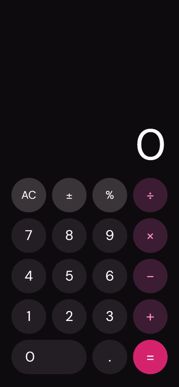</td>
    <td valign="middle">
      <ol>
        <li><b>It’s a working calculator.</b> 128 × 15 = 1920. Nothing on the screen says Saakshi.</li>
        <li><b>Her PIN, then <code>=</code>,</b> opens her vault: recordings, journal and photos, all encrypted.</li>
        <li><b>Three taps on the display</b> start a silent SOS. Every five seconds is encrypted and uploaded. Her guardians are told after ten seconds, unless she undoes it.</li>
      </ol>
      
Real screen recordings of the live app, from the demo video.

    </td>
  </tr>
</table>

## What works today

### The disguise and the SOS

<table>
  <tr>
    <td align="center">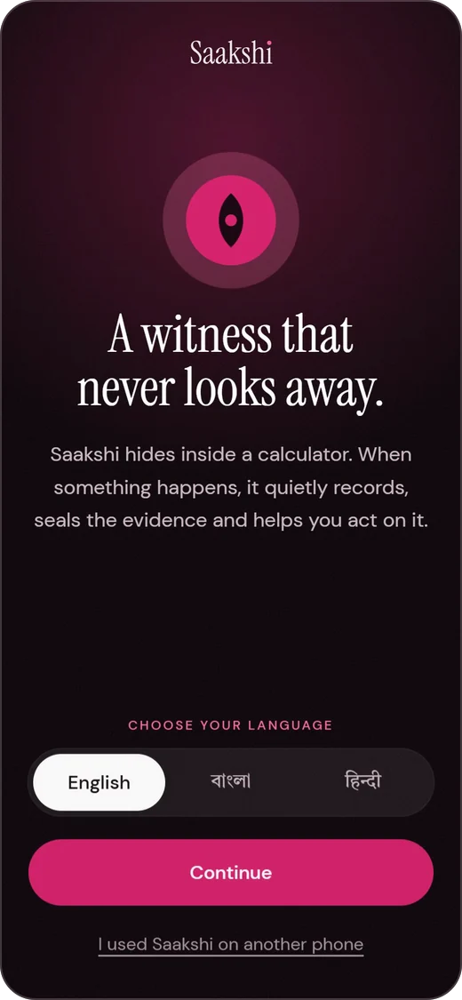</td>
    <td align="center">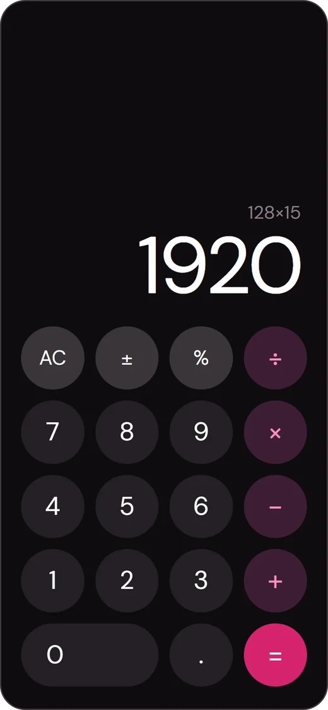</td>
    <td align="center">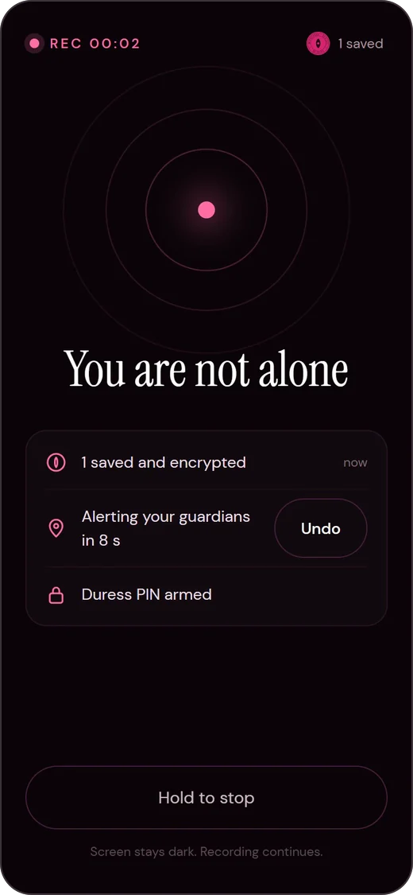</td>
    <td align="center">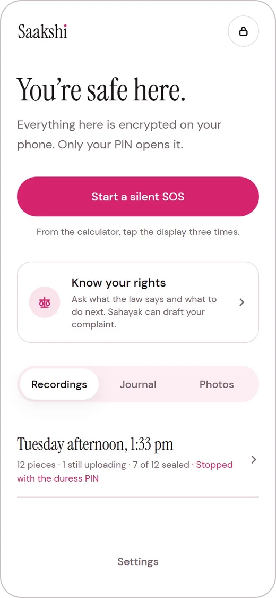</td>
  </tr>
  <tr>
    <td align="center">Setup: language, PIN and duress PIN</td>
    <td align="center">Then, all she sees is a calculator</td>
    <td align="center">Three taps: a silent SOS, ten seconds to undo</td>
    <td align="center">Her PIN and <code>=</code> open the vault</td>
  </tr>
</table>

- **Calculator disguise.** A fully working calculator. The home-screen name and icon say “Calculator”, and so do the page title, browser storage names and service worker cache.
- **Her PIN and `=`** opens Saakshi. Any other number just calculates.
- **Silent SOS.** Three taps on the calculator display. The screen goes plum, then black after 8 seconds. A wake lock keeps recording alive.
- **Encrypted 5-second pieces.** `MediaRecorder` slices video and audio every 5 seconds, plus location fixes. Each piece is fingerprinted (SHA-256 of the plaintext), encrypted on the phone (AES-GCM), written to an IndexedDB outbox and uploaded at once. Uploads retry when the signal returns.
- **Self-healing capture.** If the phone takes the camera away mid-SOS (a call, another app), recording restarts within about a second as a new segment, falling back to microphone only.
- **Duress PIN.** Typed while she is being forced to stop, it looks as if the SOS stopped, but recording carries on and the session is flagged.
- **Ten seconds to undo.** Undo erases every trace of an accidental SOS, on the phone and on the server.
- **Vault.** After her PIN she can play recordings back (decrypted on the phone), check their fingerprints, and delete one recording or everything.

### Sealed and checkable

<table>
  <tr>
    <td align="center">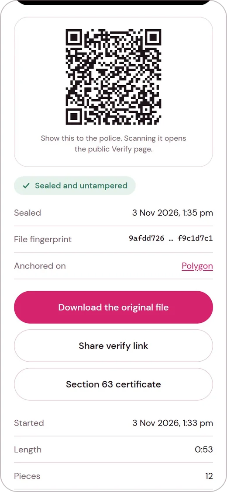</td>
    <td align="center">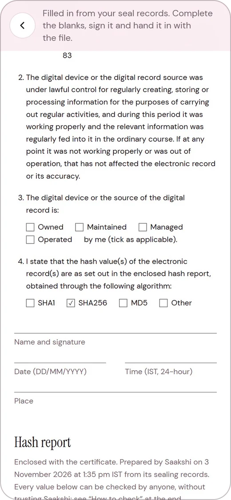</td>
    <td align="center">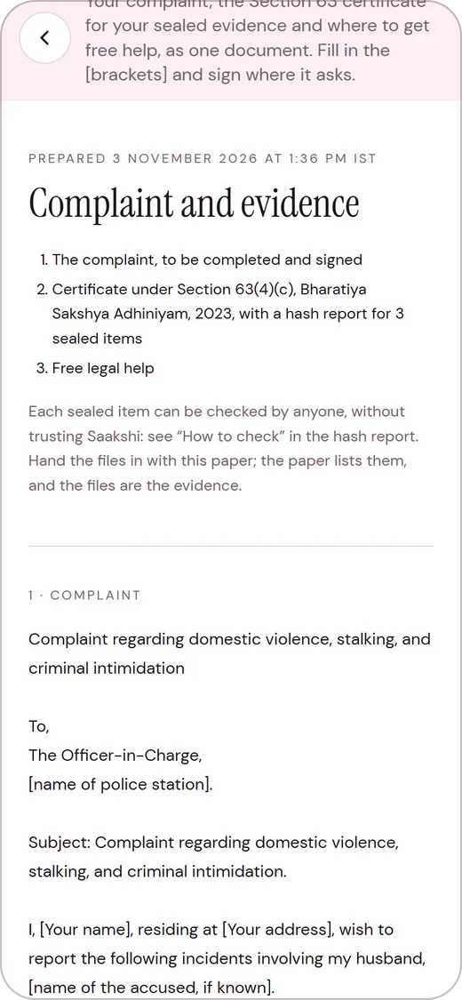</td>
  </tr>
  <tr>
    <td align="center">Sealed and untampered, with its verify QR</td>
    <td align="center">The Section 63 certificate and its hash report</td>
    <td align="center">One document for the police station</td>
  </tr>
</table>

**What she shows the police.** Every recording has a proof screen with a QR code that opens its public result. One tap prints the certificate the Bharatiya Sakshya Adhiniyam asks for with electronic evidence, filled in from the seal records; she fills the blanks and signs it.

- **Sealed on Polygon.** Each fingerprint is salted and gathered into a Merkle tree, and only the root goes on-chain, through `EvidenceAnchor` on Polygon Amoy (about 24,000 gas a root). A relayer pays, so she never needs a wallet. A database job seals every minute, even after her phone is gone.
- **Public Verify page.** Anyone can drop a downloaded recording on it. It is hashed in the browser, split into its pieces, and every Merkle proof and transaction is checked on-chain from the browser. A recording’s proof screen shows a QR code that opens its result. Without a file of your own, the page checks a sealed sample recording, then the same file with one byte changed.

  <a href="https://saakshi.dev/verify">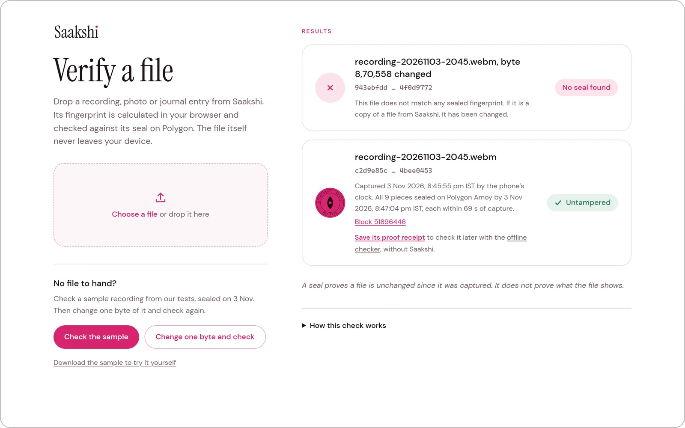</a>
   The sample recording checks as untampered. Change a single byte and no seal is found.

- **Checking without us.** After a file checks out, the Verify page saves its proof receipt. The offline checker (`web/public/verify-offline.html`, served at [/verify-offline.html](https://saakshi.dev/verify-offline.html)) is one self-contained page: given the file and its receipt, it re-hashes the pieces, climbs each Merkle proof and reads each transaction from public Polygon servers. It never talks to Saakshi, and the contract address is fixed in the page, so a forged receipt fails.

  <a href="https://saakshi.dev/verify-offline.html">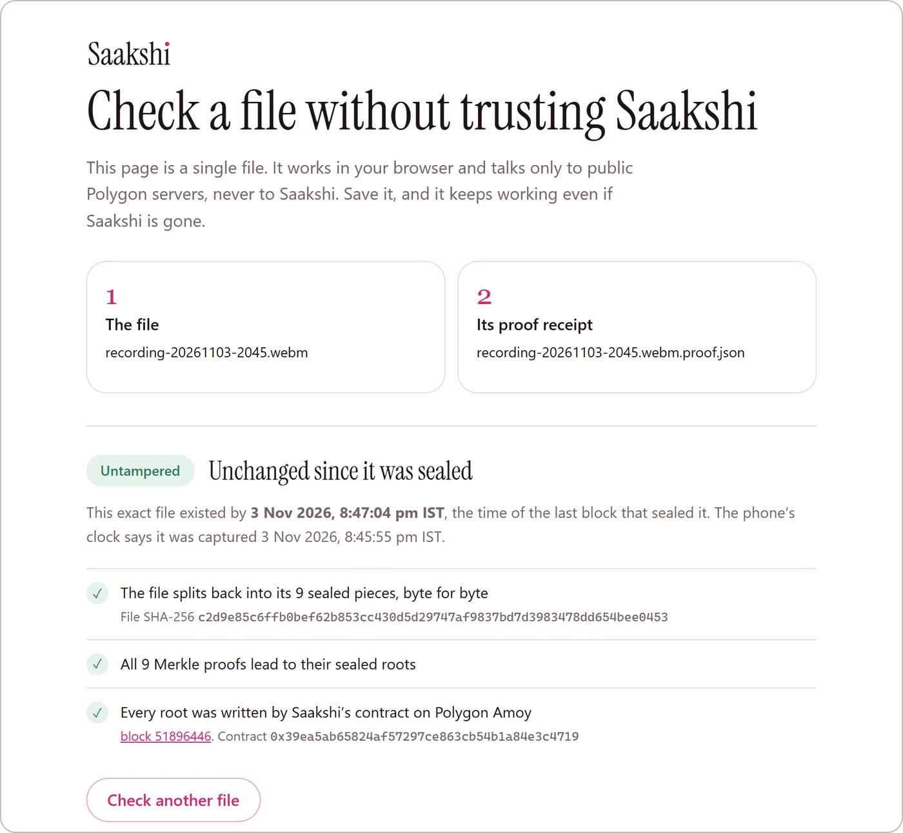</a>
   The offline checker, given the same file and its receipt. It talks only to public Polygon servers.

- **Section 63 certificate.** One tap prints the certificate the Bharatiya Sakshya Adhiniyam requires for electronic evidence: fingerprint, times, block and the verify QR code.
- **Court packet.** A complaint from Sahayak prints as one document: the complaint, the Section 63 certificate with a hash report for every sealed item it lists, and where to get free legal help.

### Beyond the night itself

<table>
  <tr>
    <td align="center">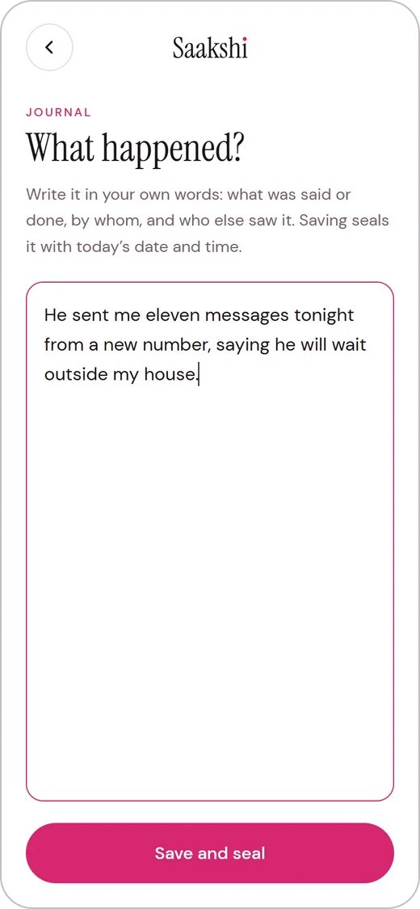</td>
    <td align="center">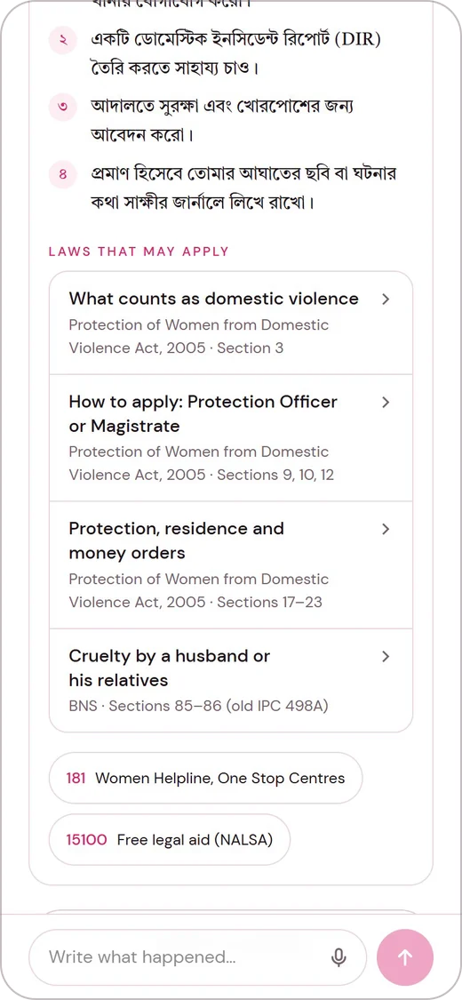</td>
    <td align="center">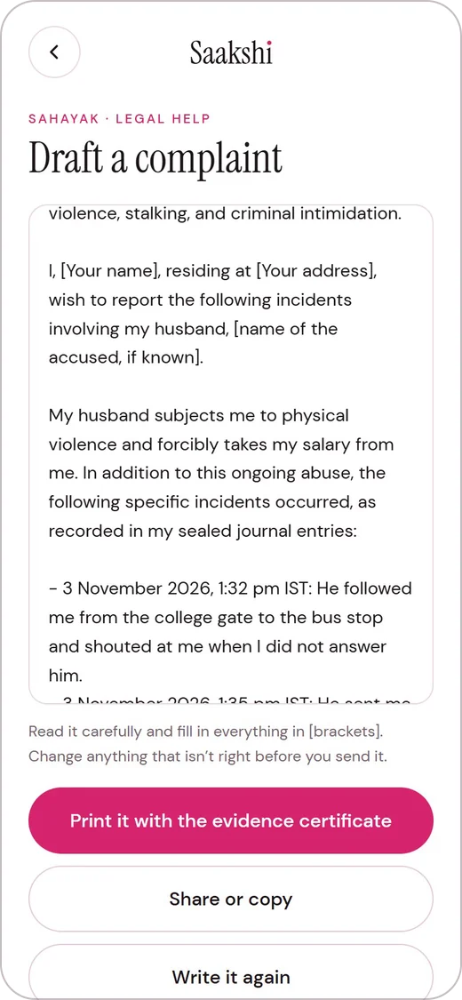</td>
  </tr>
  <tr>
    <td align="center">A dated journal, sealed when saved</td>
    <td align="center">Sahayak in Bengali, citing checked laws</td>
    <td align="center">A complaint dated from her journal</td>
  </tr>
</table>

- **Journal and photo vault.** Dated entries and photos of injuries or messages, encrypted and sealed like recordings.
- **Guardians on Telegram.** Trusted people link through the Saakshi Guardian bot. When she starts an SOS they get her live location after the 10-second undo, at once if the duress PIN is used, and a warning if her phone goes silent.

  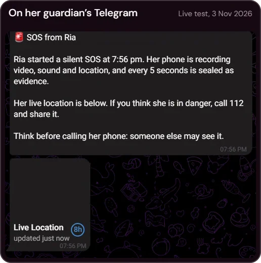
   A guardian’s Telegram during the live test on 3 Nov 2026

- **Moving to a new phone.** If her phone is lost, broken or taken, a new phone shows a six-digit code. She reads it to her guardians, who send it to the bot and approve. After two approvals (or her only guardian’s), every other device is signed out of her account, the new phone signs in with a single-use token, and her PIN opens her recordings there. Guardians vouch for her; they can never open anything.
- **Sahayak, legal help in her language.** She asks in any of 11 languages (English, Bengali, Hindi, Marathi, Telugu, Tamil, Gujarati, Kannada, Malayalam, Odia, Punjabi) or a mix, typed or spoken, and can have the answer read aloud in that language (Sarvam’s Bulbul voice). Answers may cite only ids from a checked list of 27 sections and 8 helplines (`web/lib/law.ts`), and the law cards show our text, never the model’s. Sahayak drafts:
  - an FIR request to any police station (a Zero FIR);
  - an application to a Protection Officer under the Domestic Violence Act;
  - a complaint to the Internal Committee at her workplace (POSH);
  - a takedown request to the platform under Rule 3(2)(b) of the IT Rules, 2021;
  - the text for cybercrime.gov.in.

  Each draft can list her sealed evidence. If she chooses, Sahayak also reads her journal entries on the phone and sets out the incidents in order, with the dates she wrote them.
- **Bengali, Hindi and English** throughout the app; Sahayak goes further, as above.

## How a recording becomes proof
Everything readable stays on her phone. The server only ever holds ciphertext, and the blockchain only ever holds a Merkle root.

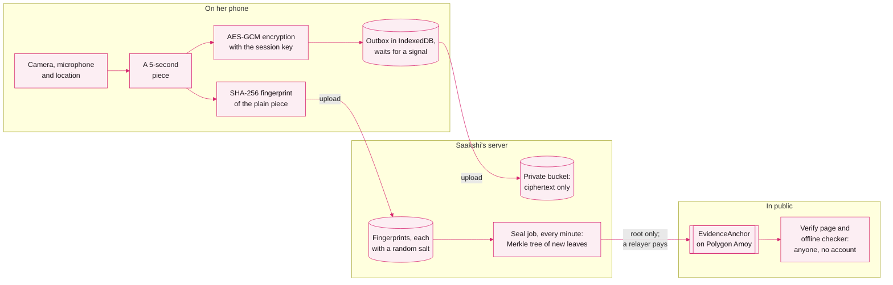

A leaf is SHA-256(salt ‖ fingerprint), so the chain reveals nothing about the file. The Verify page recomputes each fingerprint from the file, climbs its Merkle proof and reads the root from the contract.

### The first minute of an SOS

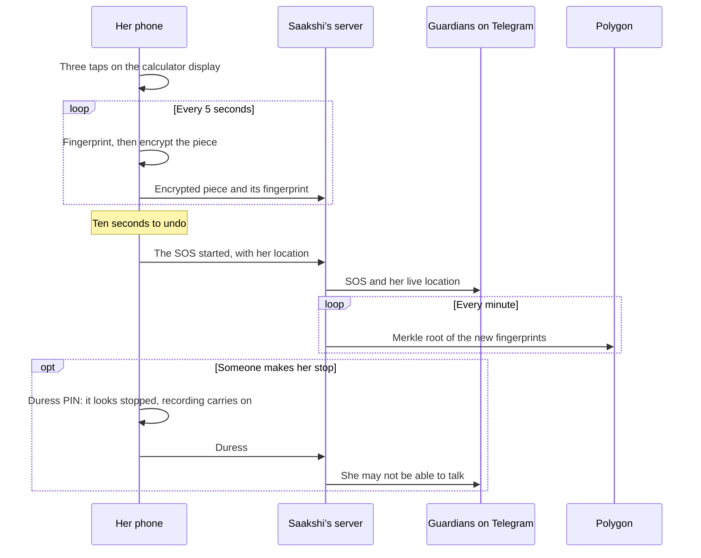

## How the encryption works
Each woman has an ECDH P-256 key pair.
- **Public key:** stays usable on the phone, so an SOS can encrypt without her PIN.
- **Private key:** wrapped with a key derived from her PIN (PBKDF2, 150,000 rounds).
- **Each session:** gets an ephemeral key pair. ECDH plus HKDF gives that session’s AES-GCM key.

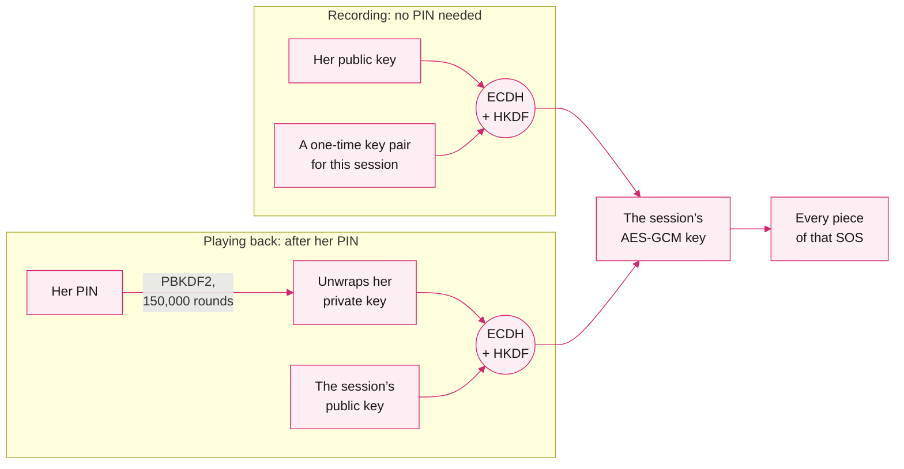

A snatched, unlocked phone can record more evidence, but it can’t read what was already recorded. The server stores only ciphertext, fingerprints and the wrapped key.

## Sahayak’s models and evaluation
Sahayak tries models in order and moves on when one is busy or slow:
1. **Gemma 4 31B through Adaption**, SHAKTI’s technology partner;
2. **Sarvam-105B**;
3. **Gemini**.

`SAHAYAK_MODELS` reorders or limits them without a deploy. Every answer must fit a JSON schema whose law and helpline fields accept only our ids.

`eval/` holds 15 situations, each asked in Bengali, Hindi and English; five of them are also asked in the other eight languages. An answer passes if it cites an expected law, is in the right language and flags danger when there is danger. Each provider was run on its own:

| Model | Passed | Median time |
|---|---|---|
| Gemma 4 31B (Adaption) | 45/45 | 3.7 s |
| Gemini (Flash and Flash-Lite) | 45/45 | 6.6 s |
| Sarvam-105B | 44/45 | 1.3 s |

In the other eight languages, the five situations (40 questions, including the danger case in each) passed 40/40, almost all answered by Gemma 4 through Adaption (`eval/results-indic.json`).

Run it against a running app with `node eval/run.mjs <base-url> [langs]`.

## Repository
| Path | What |
|---|---|
| `web/` | Next.js 16 PWA (App Router, Tailwind v4), Supabase client, Web Crypto. The showcase site is `web/app/site`. |
| `contracts/` | `EvidenceAnchor.sol` and its solc-js deploy script. `deployment.json` holds the address, ABI and compiler metadata. |
| `supabase/migrations/` | Schema, row-level security, audit triggers, the private evidence bucket and the sealing job |
| `supabase/migrate.mjs` | Applies migrations in order (`node supabase/migrate.mjs`) |
| `.github/workflows/` | Type, lint and unit-test checks on every push; a daily ping that keeps the database awake |
| `eval/` | Sahayak’s evaluation set, runner and each model’s results |
| `brand/` | Design system and UI kit (`screens.html`) that the app matches |
| `docs/readme/` | The screenshots on this page, taken from the live app |
| `round1/` | Round 1 pitch deck |
| `BUILD_PLAN.md` | Every Round 1 promise, what shipped and what changed |
| `mobile/` | The Android app (Capacitor), named Calculator; not yet proven on a phone |

## Running it
1. Put the values below in `.env.local` at the repo root (`SETUP.md` shows where to find the Supabase ones).
2. Run `node supabase/migrate.mjs`.
3. Run `cd web && npm install && npm run dev`.
4. Run the tests with `npm test`. GitHub runs them on every push, with type and lint checks (`.github/workflows/ci.yml`).

Camera, microphone, wake lock and service workers need HTTPS or `localhost`.

| Variable | What it’s for |
|---|---|
| `NEXT_PUBLIC_SUPABASE_URL`, `NEXT_PUBLIC_SUPABASE_PUBLISHABLE_KEY` | The Supabase project |
| `SUPABASE_SECRET_KEY` | Server routes: sealing, alerts, erasing |
| `RELAYER_PRIVATE_KEY` | The wallet that pays for seals on Polygon Amoy |
| `AMOY_RPC_URL` | Optional; a public Amoy RPC is used otherwise |
| `TELEGRAM_BOT_TOKEN` | Guardian alerts |
| `ADAPTION_API_KEY`, `SARVAM_API_KEY`, `GEMINI_API_KEY` | Sahayak’s models; any one is enough. `SARVAM_API_KEY` also reads answers aloud |
| `SAHAYAK_MODELS` | Optional; comma-separated model ids, in order |
| `NEXT_PUBLIC_APP_ORIGIN`, `NEXT_PUBLIC_VERIFY_ORIGIN`, `SITE_HOSTS` | Optional; the app and showcase domains |

## Honest limits
- A web app can’t keep recording reliably once the phone is locked, so Saakshi holds the screen awake and dark.
- A seal proves a file is unchanged since capture, not that what it shows is true.
- Seals go to Polygon Amoy, a test network, during the hackathon. Moving to mainnet is a configuration change.
- Moving to a new phone needs at least one guardian linked beforehand, and her PIN. If she forgets her PIN, nobody can open her recordings, us included.
- Sahayak gives legal information, not legal advice. She signs anything it drafts, and the police, a lawyer or a court decide what happens.

## Built before and during SHAKTI
Everything here was built during the hackathon, from 19 Oct 2026.
